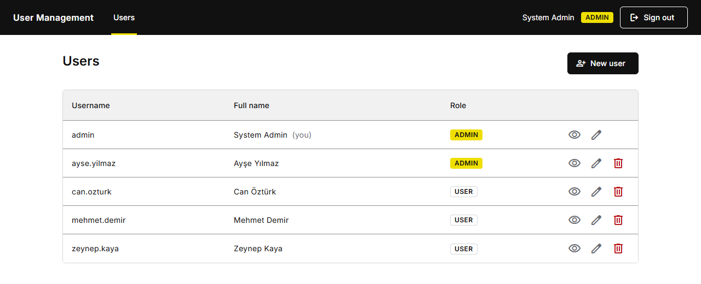
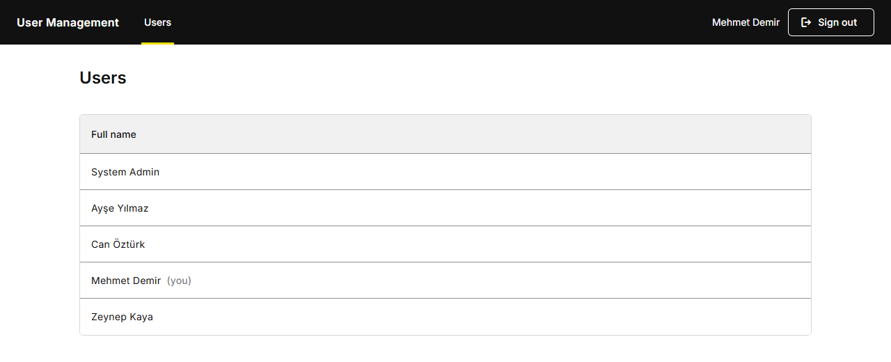
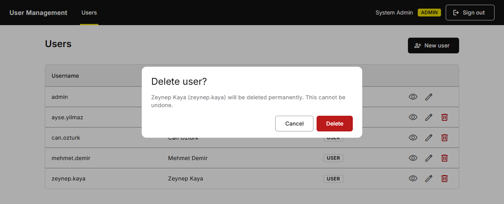

# Kullanıcı Yönetimi

[](https://github.com/BulentGurer/user-management/actions/workflows/ci.yml)

Küçük bir kullanıcı yönetimi modülü: NestJS ile yazılmış bir REST API, Angular ile yazılmış tek
sayfalık bir uygulama ve PostgreSQL veritabanı. Kullanıcılar kullanıcı adı ve şifreyle giriş yapar
ve bir JWT alır. Admin'ler kullanıcıları yönetir; standart kullanıcılar sistemde kimlerin olduğunu
görebilir.

[English](README.md)

## Özellikler

- Kullanıcı adı ve şifreyle **giriş**. API kısa ömürlü bir JWT erişim token'ı döner.
- **İki rol**
  - **Admin**: kullanıcıları listeler, görüntüler, oluşturur, düzenler ve siler.
  - **Standart kullanıcı**: kullanıcı listesini yalnızca ad soyadlarıyla görür.
- **İş kuralları**; API tarafından uygulanır (arayüz yalnızca rolün kullanamayacağı şeyleri gizler):
  - Her zaman en az bir admin vardır: son admin silinemez ve rolü düşürülemez; iki admin aynı anda
    denese bile.
  - Admin'ler kendi hesaplarını silemez.
  - Kullanıcı adları büyük/küçük harften bağımsız olarak benzersizdir ve küçük harfle saklanır.
- Swagger UI ile **API dokümantasyonu**, bir **health endpoint'i**, **güvenlik header'ları**
  (Content Security Policy dahil) ve **girişte rate limit**.
- İş kuralları, kimlik doğrulama ve yetkilendirme için **testler** (birim testleri ve gerçek bir
  PostgreSQL veritabanına karşı uçtan uca testler); Angular tarafında guard, interceptor, servis ve
  sayfa testleri.
- Docker Compose ile **tek komutla çalıştırma** ve GitHub Actions üzerinde **CI** (lint, birim ve
  uçtan uca testler, build'ler, Docker image'ları).

## Ekran görüntüleri

Admin'ler her kullanıcıyı kullanıcı adı ve rolüyle görür; görüntüleyebilir, düzenleyebilir ve silebilir:



Standart kullanıcılar aynı listeyi yalnızca ad soyadlarla görür; API onlara daha fazlasını göndermez:



Bir kullanıcıyı silmeden önce onay istenir:



## Teknolojiler

| Bölüm | Seçim |
|---|---|
| Çalışma ortamı | Node.js 26.13 (LTS) |
| API | NestJS 12, TypeORM 1 (yalnızca migration), class-validator, argon2id, Swagger |
| Web | Angular 22 (standalone component'ler, signal'ler, zoneless), Angular Material 22 |
| Veritabanı | PostgreSQL 18 |
| Dil | TypeScript 6.0 |
| Test ve lint | Vitest, Supertest, oxlint, angular-eslint, Prettier |
| Container'lar | Docker Compose, nginx 1.30 |

Tüm sürümler sabitlenmiştir: `package.json` içinde tam sürümler, commit'lenmiş lock dosyaları,
image'larda `npm ci` ve tam image etiketleri.

## Docker ile hızlı başlangıç

Gereksinim: Docker ve Docker Compose.

```bash
cp .env.example .env
docker compose up --build
```

Ardından <http://localhost:8080> adresini açın. API dokümantasyonu <http://localhost:8080/api/docs>
adresindedir.

API container'ı açılışta veritabanı migration'larını çalıştırır, demo kullanıcıları ekler (yalnızca
boş bir veritabanına) ve ardından API'yi başlatır. Yeniden başlatmak yaptığınız değişiklikleri
korur; demo verisiyle sıfırdan başlamak için veritabanı volume'ünü silin:

```bash
docker compose down -v
```

### Demo kullanıcılar

Tüm demo kullanıcılar `.env` içindeki `SEED_DEMO_PASSWORD` şifresini kullanır (`.env.example`
içinde `Demo.Pass.2026`).

| Kullanıcı adı | Ad soyad | Rol |
|---|---|---|
| `admin` | System Admin | admin |
| `ayse.yilmaz` | Ayşe Yılmaz | admin |
| `mehmet.demir` | Mehmet Demir | standart kullanıcı |
| `zeynep.kaya` | Zeynep Kaya | standart kullanıcı |
| `can.ozturk` | Can Öztürk | standart kullanıcı |

"Son admin" kuralı denenebilsin diye iki admin vardır.

## Manuel kurulum

Gereksinimler: Node.js 26.13 (bkz. `.nvmrc`) ve PostgreSQL 18. Veritabanı tek başına Docker'dan da
gelebilir: `docker compose up -d db`.

```bash
cp .env.example .env      # API ve Docker Compose için tek dosya
```

API (<http://localhost:3000/api>):

```bash
cd backend
npm ci
npm run build
npm run migration:run
npm run seed
npm run start:dev
```

Web uygulaması (<http://localhost:4200>; geliştirme sunucusu `/api` isteklerini API'ye iletir):

```bash
cd frontend
npm ci
npm start
```

## Yapılandırma

Her şey ortam değişkenleriyle yapılandırılır; değerler kök dizindeki `.env` dosyasından okunur. API
bunları açılışta doğrular; biri eksik ya da geçersizse başlamayı reddeder.

| Değişken | Amaç | Varsayılan |
|---|---|---|
| `NODE_ENV` | `development`, `production` veya `test` | `development` |
| `PORT` | API portu | `3000` |
| `WEB_PORT` | Web uygulamasının host portu (Docker Compose) | `8080` |
| `DB_HOST`, `DB_PORT`, `DB_NAME`, `DB_USER`, `DB_PASSWORD` | Veritabanı bağlantısı | port `5432` |
| `JWT_SECRET` | Erişim token'larının imzalama anahtarı, en az 32 karakter | zorunlu |
| `JWT_EXPIRES_IN` | Token ömrü, örneğin `15m`, `1h` veya `7d` | `1h` |
| `SEED_DEMO_USERS` | Boş bir veritabanına demo kullanıcıları ekler | `false` (Compose'da `true`) |
| `SEED_DEMO_PASSWORD` | Demo kullanıcıların şifresi; seed sırasında zorunlu | |
| `LOGIN_RATE_LIMIT` | İstemci IP adresi ve zaman penceresi başına giriş denemesi | `10` |
| `LOGIN_RATE_LIMIT_WINDOW` | Bu pencerenin uzunluğu, örneğin `30s` veya `1m` | `1m` |
| `TRUST_PROXY_HOPS` | API'nin önündeki, `X-Forwarded-For` header'ına güvenilen reverse proxy sayısı | `0` (Compose'da `1`) |

## API

Tüm route'lar `/api` altındadır. Giriş, health ve dokümantasyon dışındaki her route bir
`Authorization: Bearer <token>` header'ı ister.

| Metot ve yol | Kim | Açıklama |
|---|---|---|
| `POST /api/auth/login` | herkes | Kullanıcı adı ve şifreyi bir erişim token'ıyla değiştirir |
| `GET /api/auth/me` | giriş yapmış | Giriş yapmış kullanıcı |
| `GET /api/users` | giriş yapmış | Tüm kullanıcılar: admin'lere tam satırlar, standart kullanıcılara id ve ad soyad |
| `GET /api/users/:id` | admin | Tek kullanıcı, oluşturulma ve güncellenme zamanlarıyla |
| `POST /api/users` | admin | Kullanıcı oluşturur |
| `PATCH /api/users/:id` | admin | Yalnızca gönderilen alanları değiştirir; şifreyi yalnızca yenisi gönderilirse |
| `DELETE /api/users/:id` | admin | Kullanıcıyı kalıcı olarak siler |
| `GET /api/health` | herkes | API ve veritabanı durumu |
| `GET /api/docs` | herkes | Swagger UI |

Hatalar bilinen durum kodlarını kullanır: `400` geçersiz girdi, `401` giriş yapılmamış veya yanlış
kimlik bilgileri, `403` izin yok, `404` böyle bir kullanıcı yok, `409` kullanıcı adı alınmış veya son
admin, `429` çok fazla giriş denemesi.

## Testler

```bash
cd backend
npm test              # birim testleri
npm run test:e2e      # uçtan uca testler, PostgreSQL gerekir (aşağıya bakın)
npm run lint

cd ../frontend
npm test -- --watch=false
npm run lint
```

Uçtan uca testler gerçek uygulamayı, `.env` içinde yapılandırılmış sunucudaki ayrı bir veritabanına
(`user_management_test`) karşı çalıştırır. Bu veritabanı yoksa oluşturulur ve migration'larla
güncel hale getirilir; bu yüzden `docker compose up -d db` yeterlidir.

## Proje yapısı

```
backend/                NestJS API
  src/auth/             giriş, JWT guard, rol guard, decorator'lar
  src/users/            users controller, servis, DTO'lar, iş kuralları
  src/database/         TypeORM ayarları, migration'lar, demo seed
  src/config/           ortam değişkeni doğrulaması
  src/security/         şifre hash'leme
  src/health/           health endpoint'i
  test/                 uçtan uca testler
frontend/               Angular uygulaması
  src/app/core/         API istemcileri, kimlik doğrulama, guard'lar, interceptor
  src/app/features/     sayfalar: giriş, kullanıcı listesi, detay, form
  src/app/shared/       rol rozeti, onay dialog'u
  src/app/layout/       header
  nginx/                web image'ının nginx yapılandırması
docker-compose.yml      db, api ve web
.github/workflows/      CI
```

## Tasarım kararları

Her madde: ne seçildi, neden ve bedeli ne.

**"Kullanıcı detayını görüntüleme", "listeden fazlası" olarak yorumlandı.** Gereksinimlere göre
standart kullanıcılar yalnızca listeyi görebilir, kullanıcı detayını görüntülemek ise admin'lere
aittir. Bu yüzden liste yanıtı çağırana göre değişir: standart kullanıcılar API'den yalnızca id ve ad
soyad alır (yalnızca arayüzde gizlenmez), admin'ler ayrıca kullanıcı adı ve rolü alır, yalnızca
admin'lere açık detay sayfası da oluşturulma ve güncellenme zamanlarını ekler. Kullanıcı adları bir
kimlik bilgisinin yarısıdır, admin listesi de bir hedef listesidir; bu yüzden ikisi de her
kullanıcıya gönderilmez.

**Token kim olduğunu söyler, ne yapabileceğine veritabanı karar verir.** JWT yalnızca kullanıcı
id'sini taşır. Kullanıcı ve rolü her istekte yüklenir; böylece silinen bir kullanıcı ya da rolü
düşürülen bir admin, token'ın süresi dolduğunda değil, hemen erişimini kaybeder. Bedeli: istek başına
bir primary key sorgusu.

**Varsayılan olarak reddet.** Global bir guard her route'ta geçerli bir token ister; public
route'lar `@Public()` ile bunun dışında kalır. İkinci bir global guard `@Roles()` kontrol eder.
Unutulan bir decorator bu yüzden erişimi açmaz, kapatır. Eksik veya geçersiz token `401`, eksik rol
`403` verir.

**Son admin bir satır kilidiyle korunur.** Bir admin'in rolünü düşürmek ya da onu silmek bir
transaction içinde çalışır: önce tüm admin satırları kilitlenir (`SELECT ... FOR UPDATE`, id
sırasıyla; böylece iki istek asla deadlock'a girmez), sonra başka bir admin kaldığı kontrol edilir.
Kilit olmadan, birbirinin rolünü aynı anda düşüren iki admin'in ikisi de başarılı olur ve hiç admin
kalmaz; kilit kaldırıldığında uçtan uca testler tam olarak bunu gösteriyor. Bedeli: admin'ler
üzerindeki değişiklikler sırayla işlenir; bu ölçekte sorun değil.

**Kuralları veritabanı da uygular.** İsimlendirilmiş constraint'ler benzersiz, küçük harfli
kullanıcı adlarını ve geçerli rolleri garanti eder. Tekrarlanan kullanıcı adı, önce kontrol edip
sonra eklemek yerine (bu yarış durumuna açıktır) unique constraint ihlalinden anlaşılır (`409`).

**Şema değişiklikleri yalnızca migration'larla.** `synchronize` kapalıdır; her değişiklik
sürümlenmiş bir migration'dır. Docker'da migration'lar API başlamadan önce ayrı bir adım olarak
çalışır.

**Şifreler: bir arayüzün arkasında argon2id.** Servisler bir `PasswordHasher` soyutlamasına
bağımlıdır; algoritma onlara dokunmadan değişebilir. Giriş, bilinmeyen kullanıcılar ve yanlış
şifreler için aynı sürede tamamlanır (sahte bir hash doğrulanır) ve her zaman "Invalid credentials"
cevabını verir; böylece hangi kullanıcı adlarının var olduğunu ele vermez. Şifreler 128 karakterle
sınırlıdır, çünkü çok uzun girdileri hash'lemek ucuz bir denial-of-service yoludur.

**Şifre hash'i asla dönülmez.** Servis entity'lerle çalışır; controller'lar bunları alan alan
oluşturulan yanıt DTO'larına çevirir, böylece yeni bir kolon kazara dışarı sızamaz.

**Yapılandırma hızlı hata verir.** Ortam değişkenleri açılışta doğrulanır; `JWT_SECRET` eksik ya da
kısaysa API başlamaz. Hata mesajları değişkeni ve kuralı söyler, değeri asla söylemez.

**Tek origin, CORS yok.** Geliştirmede Angular geliştirme sunucusu `/api` isteklerini API'ye iletir;
Docker'da bunu nginx yapar. Tarayıcı her zaman yalnızca kendi origin'iyle konuşur.

**Token `localStorage` içinde saklanır.** Basittir ve sayfa yenilemesinden sonra da kalır. Bedeli:
bir XSS açığıyla enjekte edilen bir script onu okuyabilir; `httpOnly` bir cookie bunu engellerdi.
Öte yandan cookie, CSRF koruması gerektirir ve API'nin onu yönetmesi gerekir. Angular template
çıktısını varsayılan olarak escape eder, nginx katı bir Content Security Policy gönderir (inline
script yok, başka origin yok) ve token'lar kısa ömürlüdür.

**Giriş, IP adresi başına rate limit'lidir.** Pencere içinde `LOGIN_RATE_LIMIT` denemeden sonra API,
şifre tahminine karşı `429` döner. nginx'in arkasında istemci adresi `X-Forwarded-For`'dan gelir,
ama yalnızca `TRUST_PROXY_HOPS` kadar proxy adımına güvenilir; böylece bir istemci uydurma bir
header'la sayacını sıfırlayamaz (bir testle doğrulanır). Sayaçlar bellekte tutulur; bu tek bir API
instance'ı için yeterlidir, birden fazla instance Redis gibi ortak bir depo kullanırdı.

**Güvenlik header'ları iki sunucuda da.** helmet bunları API yanıtlarına ekler. nginx de web
uygulamasına ekler, çünkü tarayıcının çalıştırdığı HTML sayfası odur: yalnızca bu origin'e izin veren
ve inline script'e izin vermeyen bir Content Security Policy, `X-Content-Type-Options`,
`Referrer-Policy` ve frame koruması. Bunun için Angular'ın critical CSS inlining özelliği kapatıldı,
çünkü stylesheet'i inline bir script ile yüklüyor.

**Arayüz gizler, API karar verir.** Admin işlemleri standart kullanıcılara gösterilmez, ama bu
yalnızca kolaylık içindir: her kural API'de kontrol edilir.

**Sınırlarda küçük soyutlamalar.** Web uygulamasında component'ler `localStorage`, `HttpClient` veya
`MatDialog` yerine `TokenStorage`, `UsersApi` ve `ConfirmationService`'e bağımlıdır; bu da onları
test etmeyi kolaylaştırır.

**Swagger koddan üretilir.** Nest CLI plugin'i DTO tiplerini, doğrulama kurallarını ve yorumları API
dokümantasyonuna çevirir. Değerlendirenler API'yi deneyebilsin diye dokümantasyon public'tir; gerçek
bir kurulumda korunur veya kapatılırdı.

**Tarayıcıdan dışarıya istek yok.** Fontlar ve ikonlar bir CDN'den yüklenmek yerine uygulamayla
birlikte paketlenir.

**Container'lar.** Multi-stage build'ler derleyicileri ve geliştirme bağımlılıklarını çalışma
zamanı image'larının dışında tutar; API yetkisiz bir kullanıcıyla çalışır. Compose servisleri health
check'lerle sırayla başlatır: önce veritabanı, sonra API, sonra web.

## İleride yapılabilecekler

- Refresh token'lar; böylece erişim token'ları daha da kısa ömürlü olabilir.
- Kullanıcı listesinde sayfalama, arama ve sıralama.
- Kimin neyi değiştirdiğini gösteren bir audit log.
- Tarayıcıda uçtan uca testler (örneğin Playwright ile).
- Çeviriler (İngilizce ve Türkçe).
